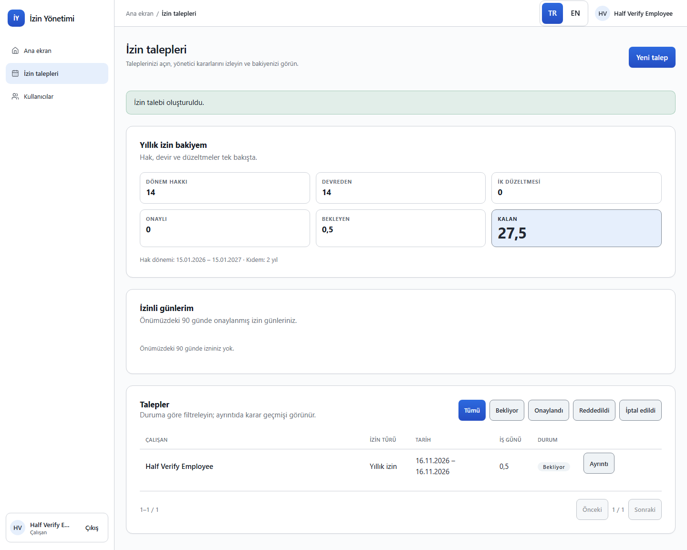
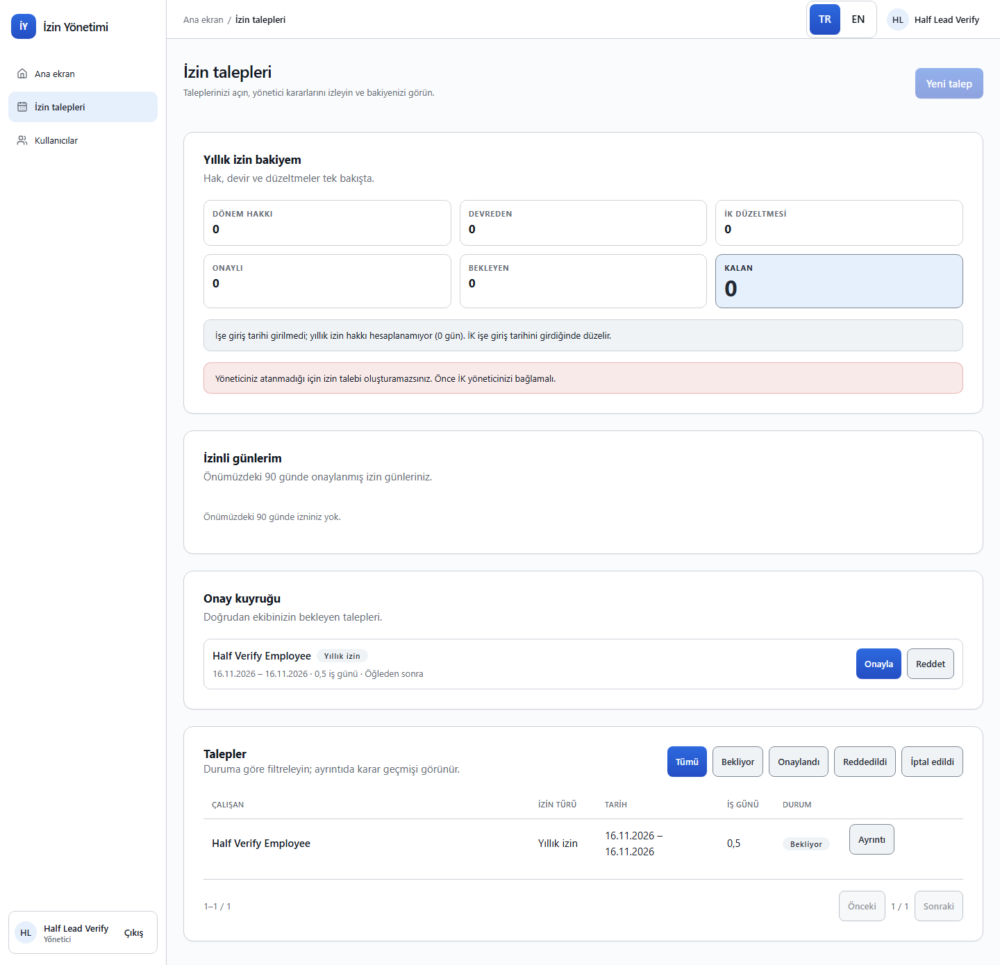
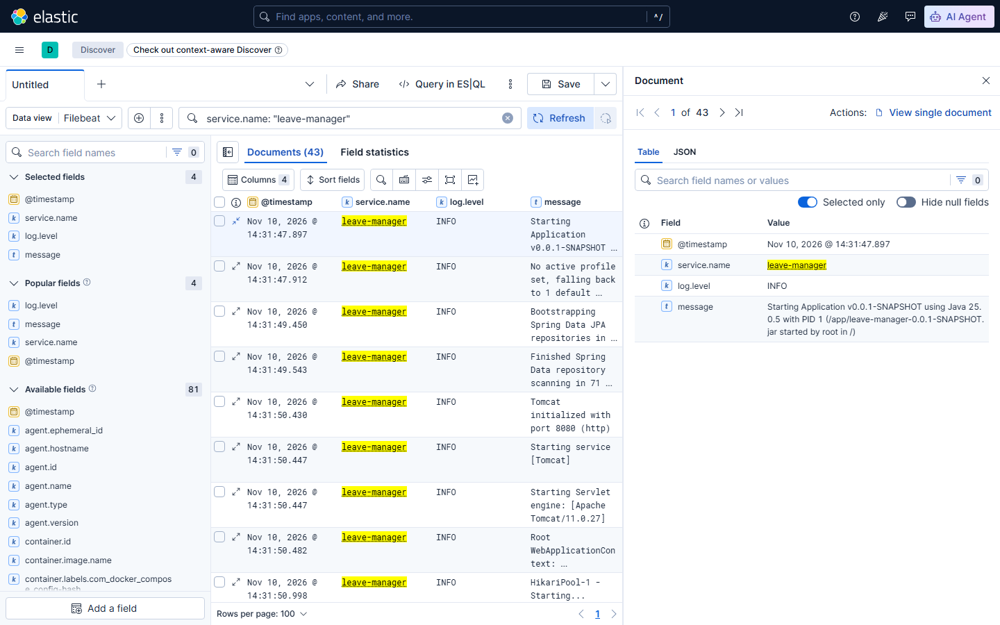

# Company Leave Manager

**1.000+ çalışanlı bir şirket için izin talebi, onay ve bakiye yönetimi** — Java 25 + Spring Boot
4.1.2 + PostgreSQL 18 API, React 19 + Vite 8 SPA; tek origin'de çalışan, rol tabanlı, denetlenebilir
bir uygulama.

[](https://github.com/altananay/company-leave-manager/actions/workflows/check.yml)
[](LICENSE)




## İçindekiler

[Neden?](#neden) · [Özellikler](#özellikler) · [Ekran görüntüleri](#ekran-görüntüleri) ·
[Teknoloji yığını](#teknoloji-yığını) · [Mimari](#mimari) · [Roller ve iş kuralları](#roller-ve-iş-kuralları) ·
[Hızlı başlangıç](#hızlı-başlangıç) · [Doğrulama ve testler](#doğrulama-ve-testler) · [API](#api) ·
[Ortam değişkenleri](#ortam-değişkenleri) · [Merkezi loglama](#merkezi-loglama-opsiyonel) ·
[Proje yapısı](#proje-yapısı) · [Dokümanlar](#dokümanlar) · [Yol haritası](#yol-haritası) ·
[Geliştirme akışı](#geliştirme-akışı) · [Lisans](#lisans)

## Neden?

Şirket içi izin süreci e-posta/Slack üzerinden yürüyordu: çalışan talebini İK'ya iletiyor, İK elle
takip ediyor ve kalan bakiye tek ekranda görünmüyordu. **Company Leave Manager** bu döngüyü tek bir
uygulamada toplar:

- **Çalışan** yılda birkaç kez, çoğu zaman telefonundan talebini açar ve ilk denemede bitirir.
- **Yönetici** günde birkaç talebi tek ekranda onaylar veya reddeder.
- **İK** yalnız bakiye düzeltmesi ve kullanıcı yönetimi yapar; onay yetkisi yoktur.
- **CEO** şirket genelinde okuma görünürlüğüne sahiptir.

Bakiye hiçbir noktada elle tutulmaz, her karar denetim kaydına yazılır ve tüm kurallar (süre, hak,
kota, yetki) sunucuda uygulanır.

## Özellikler

- **Kimlik ve roller** — `EMPLOYEE`, `MANAGER`, `HR`, `CEO`; oturum + CSRF koruması, parola
  değiştirme, 5 hatalı denemede 15 dakika kilit, İK'nın kullanıcı oluşturma/pasife alma/parola
  sıfırlama akışı.
- **İzin talebi** — yıllık, mazeret ve BR-10'un altı özel türü (evlilik, vefat, eş doğumu, karne,
  doğum günü, okulun ilk günü); yarım gün (AM/PM), iş günü hesabı (hafta sonu + resmî tatil).
- **Onay akışı** — doğrudan yöneticinin kuyruğu, onay/ret gerekçesi, iptal ve İK'nın gerekçeli
  geçmişe dönük kaydı; onay anında bakiye ve kota yeniden kontrol edilir.
- **Bakiye** — kıdeme göre hak (14/20/26), dönem devri, İK düzeltmeleri, ondalık gün (0,5) ve
  "izinli günlerim" listesi.
- **Denetim ve KVKK** — her yazma işlemi `audit_event`'e (kim/ne zaman/öncesi-sonrası); kişisel veri
  minimaldir (doğum tarihi, okul çağı bayrağı, yakınlık) ve yalnız yetkili roller görür.
- **Erişilebilirlik ve i18n** — TR/EN, axe sıfır ihlal, 44 px dokunma hedefleri, 360/768/1440 px'te
  yatay kaydırma yok.
- **Merkezi loglama (opsiyonel)** — `logging` compose profili: ECS JSON stdout → Filebeat →
  Elasticsearch/Kibana, 30 gün ILM.

## Ekran görüntüleri

| Çalışan | Yönetici |
|---|---|
|  |  |
| Bakiye, talepler ve izinli günler tek ekranda | Yönetici doğrudan raporlarının kuyruğunu onaylar |

## Teknoloji yığını

| Katman | Teknoloji |
|---|---|
| **Backend** | Java 25 · Spring Boot 4.1.2 (WebMVC, Data JPA, Security, Session JDBC, Validation, Actuator) · Hibernate · Flyway · PostgreSQL 18 · Maven Wrapper |
| **Frontend** | React 19 · Vite 8 · TypeScript 7 · Tailwind CSS 4 · Radix UI + shadcn/ui tarzı bileşenler (`web/src/ui`) · lucide-react · CVA · clsx/tailwind-merge |
| **Test** | JUnit 5 · MockMvc · Testcontainers (PostgreSQL) · ArchUnit · Vitest + Testing Library · axe-core · Playwright |
| **Altyapı** | Docker Compose (PostgreSQL; opsiyonel Elasticsearch/Kibana/Filebeat 9.5.5) · GitHub Actions |
| **Kalite** | oxlint · Prettier · `./scripts/check` (tek doğrulama sözleşmesi) · `./scripts/doctor` · `./scripts/residue` |
| **İş akışı** | ANEW: spec → plan onayı → build → bağımsız inceleme → insan triyajı → VERIFY → ship |

## Mimari

- **Modüler monolit** — `identity` (kullanıcı/oturum/rol), `leave` (talep/onay/bakiye), `audit`
  (denetim kaydı) ve `web` (HTTP, güvenlik, SPA, hata sözleşmesi). Modüller birbirine yalnız public
  `api` paketleriyle bağlanır; `internal`'a erişim ArchUnit (`ModuleBoundariesTest`) ile yasaktır.
- **Tek origin** — SPA `web/dist` olarak jar'a girer ve API ile aynı porttan servis edilir; CORS yok,
  oturum çerezi aynı origin'de çalışır.
- **Sunucu tek doğru kaynağı** — bakiye, hak ediş ve yetki kararları yalnız sunucuda; SPA iş kuralı
  taşımaz.
- **Flyway** — şema V1…V8 migration'larıyla sürümlenir; `ddl-auto: validate`.
- Ayrıntı: [docs/architecture.md](docs/architecture.md) · [docs/domain.md](docs/domain.md).

## Roller ve iş kuralları

| Rol | Yapabildikleri |
|---|---|
| `EMPLOYEE` | Kendi taleplerini açar/iptal eder; bakiyesini ve izinli günlerini görür |
| `MANAGER` | Doğrudan raporlarının kuyruğunu onaylar/reddeder; alt ağacını görür |
| `HR` | Kullanıcı yönetimi, bakiye düzeltmesi, geçmişe dönük kayıt, tüm talepler (onay yetkisi yok) |
| `CEO` | Şirket geneli okuma (onay/yazma yetkisi yok) |

**İzin türleri:** yıllık · mazeret · evlilik (5) · vefat (5, yakınlık zorunlu) · eş doğumu (5) ·
karne (1, okul çağı bayrağı, yılda 1) · doğum günü (1, 180 gün penceresi) · okulun ilk günü (1, okul
çağı bayrağı, yılda 1).

Kısa kurallar:

- Kıdeme göre hak **14/20/26** iş günü; dönem işe giriş yıl dönümünde başlar; kullanılmayan hak
  devreder (BR-1…BR-3).
- Süre **iş günü**; yarım gün yalnız tek günlük yıllık/mazeret talebinde (BR-4).
- Bakiye aşımı ve çakışma engellenir; kontrol hem talep hem onay anında (BR-5, BR-6).
- Onayı yalnız **doğrudan yönetici** verir; İK ve CEO onaylayamaz (BR-7).
- Onay bakiyeden düşer; başlamadan iptal iade eder; yalnız yıllık bakiye kullanır (BR-8, BR-9).
- Geçmişe dönük talep açılamaz; İK istisnası gerekçelidir ve denetlenir (BR-11).
- Her yazma işlemi `audit_event` üretir (BR-13). Tam liste: [docs/domain.md](docs/domain.md).

## Hızlı başlangıç

### Gereksinimler

- **Java 25** (LTS)
- **Node 24** (LTS) + npm
- **Docker** (Compose) — PostgreSQL için; e2e ve entegrasyon testleri de Docker ister
- **Playwright Chromium** (e2e için bir kez): `npm --prefix web exec playwright install chromium`
- Windows'ta `scripts/*` POSIX sh'dir; **Git Bash** kullanın

### 1. Klonla ve ortamı hazırla

```bash
git clone https://github.com/altananay/company-leave-manager.git
cd company-leave-manager
cp .env.example .env
```

### 2. Veritabanı

```bash
docker compose up -d db     # PostgreSQL 18 — host portu .env'deki DB_HOST_PORT (varsayılan 5434)
```

### 3. API

Uygulama `.env` dosyasını **okumaz**; aşağıdaki değişkenleri ortamda verin (İlk hesaplar için
`SEED_*` zorunludur; verilmezse uygulama açılır ama kimse giriş yapamaz):

```bash
export DB_URL=jdbc:postgresql://localhost:5434/leave_manager
export DB_USER=leave DB_PASSWORD=leave
export SEED_HR_EMAIL=hr@example.test SEED_HR_PASSWORD=change-this-hr-password
export SEED_CEO_EMAIL=ceo@example.test SEED_CEO_PASSWORD=change-this-ceo-password
./mvnw spring-boot:run      # http://localhost:8080
```

Sağlık kontrolü: `curl http://localhost:8080/api/health` → `{"status":"UP"}`

### 4. SPA

```bash
npm --prefix web ci
npm --prefix web run dev    # http://localhost:5173 (/api → :8080 proxy)
```

### 5. Giriş

`http://localhost:5173` → **hr@example.test** / **change-this-hr-password**

> **Port notu:** 8080 başka bir süreçte kullanılıyorsa uygulamayı `PORT=8088` ile açın ve Vite
> proxy'sini (`web/vite.config.ts`, `/api` → `http://localhost:8080`) yerelde 8088 yapın.
> Alternatif olarak `npm --prefix web run build` + uygulamayı çalıştırın: SPA aynı porttan (tek
> origin) servis edilir, proxy gerekmez.

### IntelliJ IDEA Ultimate

1. **File → Open** → proje kökü; Maven import'unu bekleyin.
2. **Project Structure → Project SDK:** 25 · **Settings → Node.js:** 24.x.
3. Docker Desktop açıkken `compose.yaml` → `db` servisini çalıştırın (veya terminal:
   `docker compose up -d db`).
4. **Run → Edit Configurations → Spring Boot:** main class
   `com.company.leavemanager.Application`; Environment variables: `DB_URL`, `DB_USER=leave`,
   `DB_PASSWORD=leave`, `PORT`, `SEED_*`.
5. SPA için `web/package.json` → `dev` script'i (veya `npm run build` + tek origin).
6. Doğrulama için IntelliJ terminalinde (Git Bash): `./scripts/check`.

## Doğrulama ve testler

Tek doğrulama sözleşmesi:

```bash
./scripts/check          # full: token kapıları + build + birim + entegrasyon + bileşen + e2e (tek kanıt)
./scripts/check --fast   # iç döngü: build + birim + bileşen + lint + compose config (docker compose plugin ister)
./scripts/e2e            # yalnız uçtan uca; kendi DB'sini ve app'ini (8083) açar, sonunda kapatır
./scripts/doctor --strict  # çalışma alanı sağlığı (spec/plan kapıları, dokümanlar, adaptörler)
./scripts/residue        # check süreç bıraktı mı? (full + fast)
./scripts/logging config # opsiyonel ELK profilinin yapılandırması (konteynersiz)
```

- **Birim:** JUnit 5 + AssertJ · **entegrasyon:** Testcontainers PostgreSQL + MockMvc ·
  **bileşen:** Vitest + Testing Library · **e2e:** Playwright (tek worker, 360/768/1440, axe).
- **Mimari:** ArchUnit modül sınırları; **tasarım sistemi:** `scripts/tokens`; **lint:** oxlint +
  Prettier.
- **CI:** GitHub Actions `check` + `doctor` işleri; her push ve PR'da tam check.

## API

| Grup | Uçlar |
|---|---|
| Sağlık | `GET /api/health` |
| Kimlik | `POST /api/auth/login` · `POST /api/auth/logout` · `GET /api/auth/me` · `GET /api/auth/csrf` · `POST /api/auth/password` |
| Kullanıcılar (HR) | `GET /api/users` · `POST /api/users` · `PATCH /api/users/{id}` · `POST /api/users/{id}/deactivate` · `POST /api/users/{id}/reset-password` |
| İzin | `GET /api/leave/requests` · `POST /api/leave/requests` · `POST /api/leave/requests/{id}/approve` · `.../reject` · `.../cancel` · `GET /api/leave/queue` · `GET /api/leave/balance` · `GET /api/leave/preview` · `GET /api/leave/days` · `POST /api/leave/adjustments` |

Tüm yazma uçları oturum + CSRF ister; kapsam dışı istek **404** döner. Hata gövdesi
`{status, code, message, requestId}` biçimindedir.

## Ortam değişkenleri

| Değişken | Varsayılan | Açıklama |
|---|---|---|
| `DB_URL` | `jdbc:postgresql://localhost:5434/leave_manager` | JDBC adresi |
| `DB_USER` / `DB_PASSWORD` | `leave` / `leave` | Veritabanı kullanıcısı |
| `DB_HOST_PORT` | `5434` | Compose DB host portu (`0` = rastgele boş port) |
| `PORT` | `8080` | API portu |
| `SESSION_IDLE_TIMEOUT` | `30m` | Oturum boşta kalma süresi |
| `SESSION_COOKIE_SECURE` | `false` | TLS arkasında `true` (prod profili varsayılanı) |
| `SEED_HR_EMAIL` / `SEED_HR_PASSWORD` | — | İlk İK hesabı (parola ≥ 12 karakter) |
| `SEED_CEO_EMAIL` / `SEED_CEO_PASSWORD` | — | İlk CEO hesabı |
| `APP_HOST_PORT` | `8085` | Yalnız `logging` profilindeki app konteynerinin host portu |

## Merkezi loglama (opsiyonel)

Varsayılan geliştirme yolu stdout'tur; uygulama her modda **JSON (ECS) stdout** yazar. İsteğe bağlı
`logging` profili aynı satırları Elasticsearch'e taşır. Stack **kendi compose projesinde**
(`leave-manager-logging`) çalışır; `down -v` yalnız onun volume'larını siler, geliştirme
veritabanına dokunmaz.

```bash
./mvnw -q -DskipUnitTests=true package     # compose app servisi target/ klasörünü bağlar
DB_HOST_PORT=0 docker compose -p leave-manager-logging --profile logging up -d
# app: docker compose -p leave-manager-logging port app 8080 (varsayılan 127.0.0.1:8085)
# Kibana: http://localhost:5601 · Elasticsearch: http://localhost:9200
./scripts/logging smoke                   # health + Kibana + log dokümanı + ILM 30d; sonunda temizler
./scripts/logging smoke --keep            # stack'i VERIFY için açık bırakır
docker compose -p leave-manager-logging --profile logging down -v
```



- Stack ~2 GB bellek ister (ES 512 MB heap + Kibana) ve **yerel geliştirme** içindir: kimlik
  doğrulama/TLS yoktur, portlar yalnız `127.0.0.1`'e bağlanır. Üretim için yönetilen küme + TLS/auth.
- Saklama: `leave-manager-logs` ILM politikası logları **30 gün** tutar, sonra siler.
- Loglarda kişisel veri/sır yoktur ([docs/security.md](docs/security.md)).

## Proje yapısı

```
.
├── src/main/java/com/company/leavemanager/
│   ├── identity/   # kullanıcı, oturum, rol
│   ├── leave/      # talep, onay, bakiye
│   ├── audit/      # denetim kaydı
│   └── web/        # HTTP, güvenlik, SPA, hata sözleşmesi
├── src/main/resources/db/migration/   # Flyway V1…V8
├── web/            # React + Vite SPA (TR/EN), e2e ve bileşen testleri
├── docs/           # mimari, domain, konvansiyonlar, test, güvenlik, git
├── specs/          # spec'ler, planlar, backlog (ANEW)
├── scripts/        # check, doctor, residue, e2e, logging, tokens
├── compose.yaml    # PostgreSQL (+ opsiyonel logging profili)
└── docker/         # Filebeat yapılandırması ve ILM politikası
```

## Dokümanlar

- [Mimari](docs/architecture.md) · [Domain ve iş kuralları](docs/domain.md) · [Konvansiyonlar](docs/conventions.md)
- [Test kuralları](docs/testing.md) · [Güvenlik](docs/security.md) · [Git](docs/git.md) · [Komutlar](docs/commands.md)
- [Spec'ler](specs/done/) · [Planlar](specs/plans/) · [Backlog](specs/backlog.md)

## Yol haritası

| Spec | Durum |
|---|---|
| 0001 — Walking skeleton | ✅ Shipped |
| 0002 — Kimlik ve roller | ✅ Shipped |
| 0003 — UI tasarım sistemi | ✅ Shipped |
| 0004 — İzin talebi akışı (A + B1 + B2) | ✅ Shipped |
| 0005 — `LEAVE_NOT_OWNER` ölü kod temizliği | ✅ Shipped |
| 0006 — Merkezi loglama (opsiyonel ELK) | ✅ Shipped |

Ertelenen küçük işler: **B-2** (health süre testi), **B-5** (Testcontainers 2.x), **B-10** (hata
eşleme tablosu karakterizasyon testi) — [specs/backlog.md](specs/backlog.md).

## Geliştirme akışı

Proje **ANEW** iş akışıyla geliştirilir: her iş bir **spec** ile başlar, planı insan onaylar,
build sonrası bağımsız inceleme ve insan triyajı yapılır, VERIFY görselleri alınır ve ship kapısı
(merge) insan tarafından açılır. Kurallar [AGENTS.md](AGENTS.md) ve [workflows/](workflows/) içinde;
testleri zayıflatmak, silmek veya atlamak yasaktır — `./scripts/check` yeşil olmadan hiçbir değişiklik
merge edilmez.

## Lisans

[MIT](LICENSE) © 2026 Engin Demiroğ
